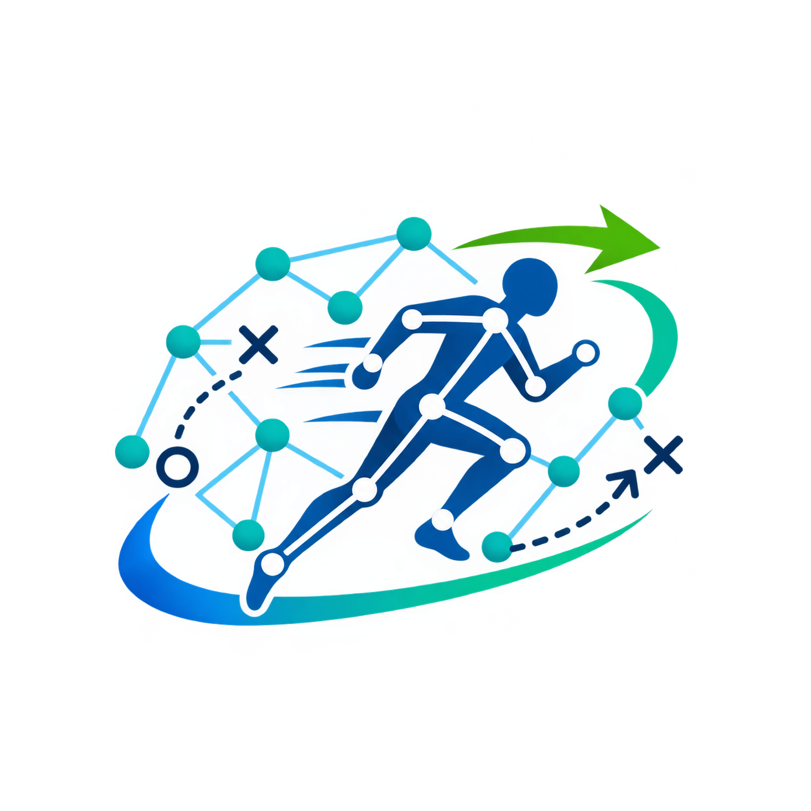
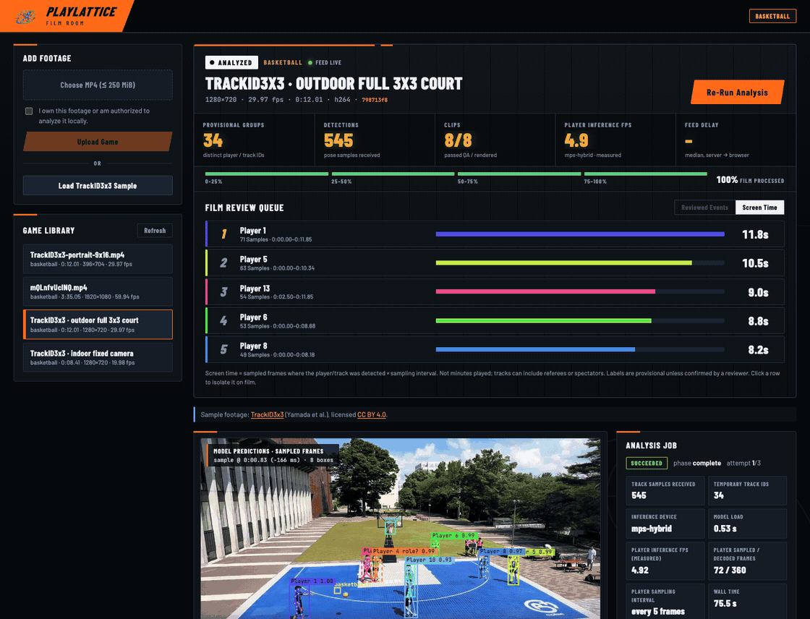

# PlayLattice

Turn basketball footage into a film room with player tracking, ball and hoop observations, reviewable basketball stats, and source-linked highlight clips.

PlayLattice is being built for the YC Naive Hackathon. The local video workflow works today; Naive SDK onboarding is set up with a capped agent and spending checks; connecting its tools to the local worker is next, followed by sponsor integrations. Basketball is the first supported sport.



*Recorded from the running app with real model predictions on the TrackID3x3 outdoor sample. Player labels are provisional; highlighted activity is not a verified basketball outcome. Footage: Kazuhiro Yamada et al., [TrackID3x3](https://github.com/open-starlab/TrackID3x3), CC BY 4.0; excerpted, resized and overlaid. [Capture details](docs/assets/README.md).*

**Phase 1 complete:** authorized input → unattended local analysis → playable clip outputs, with optional cancellation. [Acceptance evidence](docs/PHASE1_ACCEPTANCE.md).

## What you can do

The film room uses tabs for playback, players/highlights, camera shots, ball/hoop evidence, clips and analysis details. Player groups are searchable in a paginated stats table; detailed evidence opens on demand. Review drafts and the video playhead persist when switching sections.

- **Upload and analyze video.** Upload an authorized MP4 or load the included dataset sample. Analysis runs locally with automatic MPS, CUDA or CPU device selection. Cancel an active analysis from the dashboard.
- **Review the film.** Replay video with timestamped player boxes, pose keypoints, and ball/hoop observations. Player and ball models share one decode loop.
- **Correct player identity.** Inspect provisional track groups, group fragments after review, and split a track at an identity swap. Automatic IDs are not verified athlete identities.
- **Generate player highlights.** Rank candidate footage by editorial highlight priority, render clips, seek back to the original video, and review the suggested plays. Clip exports are checked for decoding, source bounds, duration and first-frame alignment.
- **Build evidence-backed stats.** Confirm the actor, event time and basketball outcome before an event contributes to a player's totals. Unknown shot values and uncertain or duplicate events remain unresolved. Totals cover reviewed evidence only.
- **Handle camera changes.** Detect hard cuts, reset tracking across camera boundaries, and keep generated clips within a shot. Review provisional gameplay classifications and export individual shots.
- **Process portrait footage.** A 9:16 crop has passed the complete analysis and clip-export flow. A narrow frame can lose players, the ball and surrounding play.

Jobs, review state and replayable updates persist in SQLite. Uploaded media, model weights and generated videos remain in ignored local storage.

## Run locally

From the repository root, install dependencies, model weights, and the sample once, then start the app:

```sh
./setup.sh
./run.sh
```

Open **http://127.0.0.1:5173**. The runner starts the API, frontend, and existing configured Naive crew, reusing services already running. Ctrl-C stops only services it started. Logs are in `data/logs/`. It does not enable publishing or create Naive accounts or agents. On a fresh checkout, Naive onboarding and private crew configuration are separate; Film Room still runs without them.

Use `./setup.sh --check` to check installed prerequisites and `./run.sh --check` to check running services. Setup supports `--skip-models`, `--skip-sample`, and `--no-ball`; the runner supports `--no-crew` for local analysis only. Node.js with `node:sqlite` support (22.13+) and Python 3.9–3.12 are required by the pinned dependencies. Set `PLAYLATTICE_PYTHON` when selecting Python for initial setup.

Manual setup is also available:

Requires Python, Node.js/npm, and FFmpeg/ffprobe. The current setup has been exercised on macOS arm64 with Python 3.9.6; see the [local setup guide](docs/LOCAL_PROTOTYPE.md) for platform notes.

```sh
# macOS: install FFmpeg if needed
brew install ffmpeg

python3 -m venv .venv
.venv/bin/python -m pip install -r requirements.txt
.venv/bin/python scripts/download_pose_model.py

# Enable basketball-trained ball and hoop detection
scripts/setup_ball_detector.sh

# Download the short outdoor 3x3 sample
.venv/bin/python scripts/download_sample.py --outdoor

npm --prefix frontend ci
npm --prefix frontend run build
scripts/run_local.sh
```

Open **http://127.0.0.1:8000**, choose **Analyze TrackID3x3 Sample** or **Upload & Analyze**. Analysis and clip generation start automatically; the dashboard opens Clips on completion. For your own footage, confirm that you are authorized to analyze it before uploading. Initial setup downloads dependencies and model weights; inference runs locally after setup.

For frontend development, run `npm --prefix frontend run dev` alongside the API. Vite proxies `/api` to port 8000.

## Models and current limits

| Component | Active implementation |
| --- | --- |
| Player detection and pose | Pinned Ultralytics YOLO26n-pose; 17 keypoints; default stride 5 |
| Ball and hoop detection | Basketball-trained E-BARD RF-DETR Nano; default stride 2 |
| Identity and continuity | Conservative tracking and anonymous grouping, with reviewer corrections |
| Highlights | Visual-activity heuristics and reviewer-confirmed outcomes, rendered with FFmpeg |
| Storage and UI | FastAPI, SQLite, React, TypeScript and Vite |

This is sampled video analysis, not demonstrated real-time game coverage. Model inference is the main runtime cost. Ball observations can be sparse, identities can swap or fragment, and hard-cut/gameplay heuristics need review. The current models have been checked on short indoor/outdoor 3x3 clips; this does not establish accuracy across full games, leagues or camera styles.

We benchmarked basketball-trained YOLOv8n against RF-DETR on the same 264 frames and three-view settings on MPS. YOLO took 9.2 seconds versus RF-DETR's 62.5 seconds, but detected balls in only 39 frames versus 164 and hoops in zero frames versus 264. These are **detection coverage and detector timings, not accuracy or full-job latency**. RF-DETR remains active. Adaptive crop and cross-frame batching experiments are archived and are not enabled in production analysis. [Benchmark details](docs/EBARD_MODEL_BENCHMARK.md).

Player scores express clip-review priority, not player ability. Official statistics, verified rosters, private athlete profiles, automatic jersey identification, recruiting workflows, full Naive tool orchestration and sponsor plugins are not implemented.

## Checks

```sh
.venv/bin/python -m pytest backend/tests -q
.venv/bin/ruff check backend workers scripts
npm --prefix frontend run build
```

The current backend suite has 196 passing tests. UI readability was checked in desktop and mobile Chrome. Real-video inference and export checks are separate from unit tests; passing software checks does not establish basketball recognition accuracy.

## Further reading

- [Detailed Naive integration and company-team plan](docs/NAIVE_INTEGRATION_PLAN.md)
- [Naive SDK setup, approved budgets and monitoring](integrations/naive/README.md)

- [Autonomous Phase 1 acceptance](docs/PHASE1_ACCEPTANCE.md)
- **[Developer handoff and next priorities](docs/HANDOFF.md)**

- [Local setup and operation](docs/LOCAL_PROTOTYPE.md)
- [Unified player and ball analysis](docs/UNIFIED_ANALYSIS.md)
- [Camera cuts and gameplay review](docs/CAMERA_SHOTS.md)
- [Reviewed basketball statistics and attribution](docs/REVIEWED_STATS_CONTRACT.md)
- [Highlight scoring and clips](docs/HIGHLIGHT_SCORING.md)
- [Tracking evaluation](docs/TRACKING_HANDOFF.md)
- [YOLO26 pose validation and tradeoffs](docs/YOLO26_POSE_VALIDATION.md)
- [GPU acceleration and CUDA worker setup](docs/ACCELERATION.md)
- [Ball model benchmark](docs/EBARD_MODEL_BENCHMARK.md), [crop experiments](docs/BALL_PERFORMANCE_PLAN.md), [batching experiments](docs/BALL_BATCHING_RESULTS.md)
- [API and worker contract](docs/API_CONTRACT.md)
- [TrackID3x3 findings and attribution](docs/datasets/TRACKID3X3.md)
- [Agent instructions](AGENTS.md) and [implementation plan](docs/PROTOTYPE_PLAN.md)
- [Planning document](https://docs.google.com/document/d/1kEtq_jr14fybmyRyH_d0h5GALDyeX0YExyt-AdtnJrM/edit)

The repository is private. Model, runtime and dataset terms are separate: Ultralytics YOLO26n-pose uses AGPL-3.0 or an Enterprise license; E-BARD model weights are labeled CC BY 4.0; RF-DETR code is Apache 2.0. See the pinned download manifests and linked model documentation for provenance.
