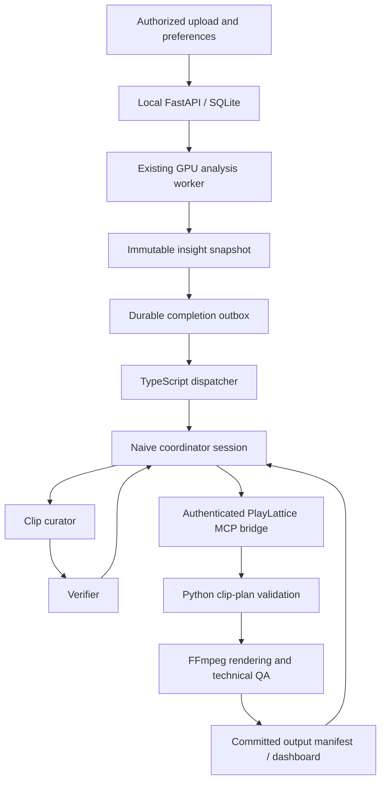

# PlayLattice → Naive autonomous clipping integration

Draft for implementation, 2026-11-07. Baseline: `develop` at `d18f047`; local Phase 1 is complete. This plan does not provision agents, change budgets, deploy a bridge or start paid tests.

## 1. Goal and acceptance target

**Authorized video input → automatic analysis → agent-selected highlights → validated playable outputs.** No human approval, identity confirmation, event review or Generate click is required between input and output. A user can cancel during analysis, agent work or rendering.

First end-to-end target: submit a short basketball video once, produce up to five distinct source-linked clips with selection reasons, expose them in the existing dashboard, and record job/session provenance and actual cost. Fewer clips or an explicit empty result are valid when evidence is insufficient. An uncertain identity must never become a verified athlete just to fill the requested clip count.

The Naive company is the existing **PlayLattice AI organization**. We will build a small team within it, not create another organization or install an unrelated company template. Sponsors, publishing, outreach, profiles and new sports remain outside this milestone.

## 2. What exists and what must be built

| Already implemented | New integration work |
| --- | --- |
| Upload automatically queues a durable analysis | Durable handoff from analysis completion to Naive |
| One decoder with YOLO26 pose and RF-DETR ball/hoop inference | Immutable, compact, job-scoped insight snapshots |
| Provisional identities, camera-shot boundaries and candidate clips | Typed autonomous selection and verification tools |
| FFmpeg rendering, hashes, decoding/range/duration QA | Explicit clip-plan validator and asynchronous renderer |
| SQLite jobs/audit, replayable updates and cancellation | Workflow state linking CV jobs, Naive threads and render jobs |
| Tabs, player table and playable clips | Workflow progress, reasons, costs, fallback and cancellation UI |
| Pinned TypeScript SDK/CLI and authenticated account | Authenticated remotely reachable tool bridge |
| One capped curator and successful metadata smoke | Coordinator + curator + verifier roles and team acceptance |

The current highlight-generation route accepts clip-count parameters; it does not accept an arbitrary agent-selected time-range plan. The existing shot export renders an entire camera shot. Neither should be presented as the proposed clip-plan API.

The onboarding smoke supplied real metrics as text to the agent. It did not demonstrate a hosted agent fetching the local API, inspecting video or rendering clips. Its recorded spend was $0.00051; that is not a forecast for the full workflow.

## 3. Company team and responsibility boundaries

| Role | Responsibility | Allowed capabilities | Output |
| --- | --- | --- | --- |
| Coordinator | Own the video task; delegate; handle bounded recovery; deliver results | Read workflow/evidence, delegate to pinned roster, submit a validated plan, inspect render status | Final job result and explanation |
| Clip curator | Select coherent, non-duplicate sequences with useful lead-in/out | Read scoped candidate evidence and bounded visual evidence when supported | Structured clip plan with source reasons |
| Verifier | Independently challenge selections, attribution and visual claims | Read the frozen plan/evidence and bounded previews; read technical QA | Structured pass/revise/drop decisions |
| Deterministic Python worker | Decode, infer, enforce bounds, render and independently check media | Existing local model/render functions | Observations, manifests, MP4s and QA |

Reuse the existing curator agent ID. Add two agents only when the corresponding milestone is ready. No nested delegation or dynamic hiring. Curator and verifier do not receive shell, billing, messaging, publishing, credential-management or arbitrary file tools.

Use version-pinned coordinator roster entries and bounded point-to-point delegation. Naive represents a team as a coordinator agent with a roster, not a separate company/team resource. A shared board can later mirror progress; the local workflow database remains authoritative. [Team reference](https://usenaive.ai/docs/team/overview).

Technical QA stays deterministic: another LLM is not needed to count frames or compute hashes. The verifier's useful work is semantic evidence consistency and, once supported, visual inspection. The existing text smoke does not establish the current model's visual-input support. Validate a model's actual image/video request format and cost before giving the verifier visual work. Until then, label verification as metadata consistency, not visual validation.

## 4. Architecture and connectivity



**Initial connectivity choice:** a dedicated loopback MCP service with an authenticated TLS tunnel to that service only. Do not expose the existing unauthenticated FastAPI port or tunnel arbitrary media/filesystem endpoints. The bridge calls approved local services and immediately returns durable job IDs for long work. GPU processing does not run inside an MCP request or Naive sandbox.

Before choosing a tunnel provider, check the operator's available account, connection lifetime, stable URL support and cost. No provider or paid hosting is selected by this draft. The URL and credential must be established before enabling tools on the agents. If a reliable authenticated tunnel is unavailable, use a hosted authenticated command relay with a worker that polls outbound; do not weaken authentication to make a demo connect.

For a later deployed version, replace the laptop/tunnel dependency with an outbound worker queue or GPU service. Keep the same tool contract so that this is a transport change. Do not claim Naive supplies CUDA/MPS hardware; current inference stays on the local worker.

The MCP bridge authenticates a scoped credential distinct from the Naive organization key, binds requests to the intended organization/workflow, limits request sizes/rate, and restricts media access to registered artifacts. Agent vault/server configuration supplies the credential; no secret appears in prompts, frontend JavaScript or Git. Rotate the key previously shared in chat before external bridge deployment.

## 5. Workflow lifecycle

1. The user supplies authorized footage and optional preferences at submission: scope (whole game or an existing provisional player group), maximum clips and output constraints. Default output preserves source aspect ratio.
2. Existing server-side ingest starts one CV job. A new durable workflow record links to it. Never start a duplicate analysis merely because an agent asks for status.
3. On CV completion, write an outbox event in the same persistence boundary as workflow readiness. A local TypeScript dispatcher claims it with a lease, then creates/reconciles one Naive root session using a stable idempotency key.
4. Freeze an insight snapshot bound to source hash, analysis job, shot ranges, identity revision and effective evidence. The snapshot is immutable and paginated; later edits produce a new revision.
5. The coordinator delegates a bounded candidate-selection brief. The curator receives only the relevant snapshot slice, not every frame or another agent's transcript.
6. The verifier returns pass/revise/drop decisions. Allow at most one plan-revision cycle in the first implementation, within the same root budget. No repeated committee loop.
7. The backend validates the proposed plan. It may reject illegal ranges or drop unsupported attribution; it never treats natural-language reasoning as authority to bypass source bounds.
8. Enqueue FFmpeg rendering, poll machine state and run deterministic QA. When visual verification is supported, give the verifier one bounded post-render preview check; a failed semantic check drops the clip or uses the single permitted revision cycle. Do not rerun inference for a new cut of the same analyzed source.
9. Atomically commit the clip package only if the workflow is still active and snapshot revision is valid. The dashboard receives final clips, reasons, warnings and actual costs.
10. On any terminal failure, produce explicit failure/partial/fallback output. Do not ask the user to approve clips or increase a budget to finish the normal flow.

Proposed workflow states: `waiting_for_analysis → snapshot_ready → selecting → verifying_plan → rendering → verifying_outputs → succeeded`. Terminal alternatives: `completed_with_fallback`, `no_eligible_clips`, `failed`, `cancelled`; cancellation passes through `cancelling`. Provider `awaiting_approval` is a configuration failure for these approved tools, not a normal product state. Budget exhaustion is surfaced as an output condition and does not automatically increase limits.

## 6. Proposed contracts and tools

The names in this section are new PlayLattice interfaces to implement, not existing Naive SDK methods.

| Proposed tool | Input | Result | Mutates |
| --- | --- | --- | --- |
| `get_workflow` | `workflow_id` | Current analysis/session/render state and errors | No |
| `get_analysis_insights` | `workflow_id`, snapshot ID/cursor | Compact, immutable evidence and uncertainty | No |
| `get_visual_evidence` | Scoped candidate IDs and bounded source windows | Expiring preview/frame references, when visual input is supported | Creates bounded cache only |
| `validate_clip_plan` | Workflow/snapshot + structured plan | Normalized valid plan, violations and dropped claims | No execution |
| `render_clip_plan` | Validated plan ID/hash + stable request key | Render job ID | Yes |
| `get_render_result` | Workflow/render job ID | QA, registered artifacts and provenance | No |
| `cancel_workflow` | Workflow ID + explicit cancellation request | Durable cancelling/cancelled state | Yes |

Optional ingress tool `submit_analysis` is only for an authorized pre-registered source, not an arbitrary URL/path; the normal upload already starts analysis. It must reuse matching work or explicitly reject conflicting configuration.

MCP policy: default deny; explicitly allow only the role's pre-authorized processing tools. Do not use `ask` for normal analysis, selection, rendering, status or cancellation. Deny external publication/messages, payments and destructive administration. Naive's MCP/tool policy supports this separation; verify actual names from `tools/list` before enabling them. [Tool policy reference](https://usenaive.ai/blogs/naive-inside-your-agent-framework).

### Insight snapshot

Required envelope: `schema_version`, `workflow_id`, `game_id`, `analysis_job_id`, `source_sha256`, `snapshot_id`, `identity_revision`, `created_at`, source dimensions/FPS/duration, analysis coverage and model provenance.

Evidence includes shot IDs/bounds/categories, candidate IDs/source ranges, provisional actor references and association state, raw editorial score components, available ball/hoop evidence and data-quality warnings. Coordinates remain normalized xywh; times remain original-source milliseconds. Unknown is explicit. Paginate track samples and provide summaries by default so prompts do not grow with video length.

Freeze snapshot content under one consistent DB read boundary. `snapshot_id` is a canonical content hash including effective shot/review/group state, not merely the job ID. A correction or newer analysis must not silently change what an in-flight agent saw.

### Clip plan

```json
{
  "schema_version": "1",
  "workflow_id": "opaque-workflow-id",
  "snapshot_id": "immutable-snapshot-hash",
  "clips": [
    {
      "candidate_id": "existing-candidate-id",
      "shot_id": "existing-shot-id",
      "start_ms": 2400,
      "end_ms": 7400,
      "actor_track_ids": ["existing-track-id"],
      "attribution": "provisional",
      "reason": "A coherent movement sequence with visible lead-in and follow-through",
      "event_claim": "visual_activity"
    }
  ],
  "output_mode": "source_aspect"
}
```

This is illustrative schema, not a fabricated detected event. Validate every ID and time against the frozen source. Initial constraints: at most five clips, at most 60 seconds of total output and at most 15 seconds per clip, clamped to actual video/shot bounds. Do not force five clips from a short source. Deduplicate substantial overlaps and repeated evidence for the same sequence; retain selection reasons separately from measured scores.

Reject cross-cut clips and out-of-source ranges. Lead-in/out padding stops at the camera boundary. Uncertain identities become general gameplay clips without person attribution, or are omitted. `made_shot`, assists and similar semantic labels require adequate automatic visual evidence and separate evaluation; the default remains `visual_activity`. Never auto-fill the manual confirmed-stat ledger to make a dashboard look complete.

### Render and final results

Add proposed internal HTTP routes for scoped snapshots, validated plans, asynchronous render jobs and workflow cancellation. Final route names must be frozen in API_CONTRACT.md before implementation; avoid bolting arbitrary ranges onto the existing review endpoint.

Use existing `render_clip` and `verify_clip`. Produce a package containing source/job/snapshot IDs, final ranges, selected/dropped reasons, clip/media IDs, hashes, measured durations, decode/range/alignment QA, provisional attribution, warnings, agent/thread/model versions and actual usage. Failed QA never yields a playable-success card. Keep source hash and edit recipe as provenance; first-frame alignment alone cannot prove the correct play was selected.

## 7. Persistence, idempotency and recovery

Persist a workflow, completion outbox, immutable snapshots/plans, render jobs, remote session/thread links, cancellation state and event checkpoints in local SQLite using the repository's existing patterns. An outbox lease has an expiry so a crashed dispatcher can recover without a new user action. Commit state before acknowledging work.

A render execution key is derived from source hash, analysis ID, snapshot ID, canonical plan hash and output configuration. Same key/body returns the same job; conflicting body returns 409. Naive session-create retries reuse the identical request body and key. Reconnect and resume events by sequence; do not create a new session merely because streaming broke. Give SSE a dedicated reconnect/idle policy rather than reusing the current client’s 20-second ordinary HTTP timeout. A status-read failure is not evidence that the agent task failed.

| Failure | Autonomous behavior |
| --- | --- |
| Status read timeout / 429 / transient 5xx | Back off, respect Retry-After, retain checkpoint; no new paid task |
| Ambiguous session-create response | Reconcile/replay the same idempotent submission |
| `end_turn` response followed by transport timeout | Inspect persisted output/events before cancellation or retry |
| CV transient error | Existing bounded whole-job retry owns recovery; dispatcher does not stack another inference retry layer |
| Invalid plan | Return typed violations; one bounded revision cycle; then omit/fallback |
| Snapshot changed | Refuse stale render; refresh once within the existing workflow budget or return safe fallback |
| Render crash | Retry the same execution job within limits; publish only verified registered artifacts |
| Budget exhausted / provider unavailable | Return existing Phase 1 verified clips as clearly labeled fallback when available; otherwise explicit failure/empty output |
| Cancel during completion | Cancellation flag wins before final commit; late tool results cannot restore outputs |

A fallback is identified as the local heuristic package, not claimed as agent-selected or visually verified. Cancel any leftover remote task when ending in fallback, and persist unresolved cancellation for reconciliation; do not leave an orphan that may publish late results. Return an honest pending-cancellation state while remote acknowledgement is unavailable.

## 8. Cancellation and user control

Keep Cancel visible during the entire combined workflow, including after the CV job succeeds while agents/rendering are still active. The current CV-only cancel endpoint is insufficient for that later phase, so add workflow-level cancellation and UI state.

Cancellation durably prevents new delegation, cancels the root and child sessions using verified platform behavior, stops owned CV/render work, removes this workflow's partial registrations, and retains source footage and previously completed independent outputs. A workflow that reuses someone else's completed/shared analysis must not cancel or delete that analysis. Check cancellation before expensive calls and immediately before publishing outputs.

Test cancellation while queued, during inference, during delegation, during rendering, after a network disconnect and racing final commit. Cancellation is an optional user override, never a required approval step.

## 9. Budgets, observability and team accounting

Keep the operator's approved **$10/month total allocation** and **$1 per video task**. Proposed monthly split: coordinator $2, curator $5, verifier $3. The existing curator's $10 cap must be migrated down rather than leaving it in place and adding another $10 of agents. This draft makes no budget change.

Use one explicitly $1-budgeted root session with bounded delegated work. Naive documents shared root-session ceilings for waited delegation; member monthly caps remain separate, so root monthly cap alone is not a team cap. Board-assigned top-level jobs have independent budgets and must not be used to launch the initial clip workflow. Confirm accounting with a small live team test before fan-out. [Context and budget semantics](https://usenaive.ai/docs/team/context-and-budgets).

Naive's server remains the monetary enforcement point. The app displays ledger-derived usage, records approved settings and stops/falls back on refusal; it does not implement a competing financial ledger. Never auto-top-up, change a plan or raise a limit. Ask the operator outside the video runtime if later testing requires more than $1/task.

Record per-workflow wall time, model calls, CV time, render time, validation failures, retries, selected/dropped counts and costs per member. Avoid double-counting team cost: reconcile the root plus its actual member threads with server usage. Account balance includes other existing agents and subscription activity, so balance delta alone is not this workflow's cost. The present local watcher is observational and requires the machine/process to remain running.

## 10. Implementation sequence and acceptance gates

| Milestone | Concrete deliverable | Exit condition |
| --- | --- | --- |
| A — Contract and snapshots | Scoped immutable insight endpoint, canonical types, workflow record | Two jobs for one game cannot leak/mix snapshots; corrections change revision; no secrets/paths exposed |
| B — Explicit plan rendering | Plan validation + asynchronous renderer + registered manifests | A deterministic plan produces source-correct clips with no inference rerun; invalid/cross-cut/stale plans fail |
| C — Secure tool connection | Dedicated MCP server and authenticated reachability | Hosted diagnostic calls real scoped read tools; unauthenticated/wrong-scope calls fail; original API remains loopback |
| D — Durable single-agent path | Completion outbox/dispatcher, session reconciliation, automatic output delivery | One input finishes with no manual action; duplicate events and restart create no duplicate sessions/artifacts |
| E — Company team | Coordinator and verifier, existing curator migrated, pinned roles/delegation | Three-role run respects verified root $1 ceiling and total monthly allocations; no nested/independent board runs |
| F — Visual verifier | Supported visual model/input format, bounded previews and typed judgments | Demonstrate actual visual input, source-grounded judgments and drop/abstain behavior; record actual cost |
| G — UI and acceptance | Combined progress/cancel/result package, failure/restart tests, updated handoff | Full input-to-output and cancellation suite passes on real footage; fallbacks/limits remain clear |

D is a diagnostic stepping stone, not the intended final company design. If visual support is ready earlier, implement F before the final E/G demonstration. Do not declare full semantic verification when only metadata checks ran.

### File ownership for implementation sessions

- Integration lead: API_CONTRACT.md, shared types/migrations, acceptance evidence, configuration and final integration.
- Backend: proposed `backend/app/insight_routes.py`, `workflow_routes.py`, `clip_plan_routes.py`, workflow persistence/service code and boundary tests.
- Video/render: proposed plan validator/render adapter under `workers/render/`, existing media QA reuse and camera/coordinate tests. Avoid changing active models.
- Naive integration: `integrations/naive/src/` dispatcher, MCP service/tools, session/event persistence, team specification and spend checks.
- Frontend: combined workflow progress/cancel/output UI through api.ts/types.ts; preserve current tabs and Phase 1 route behavior.

After the lead freezes shared types, backend rendering and local tool-adapter work can proceed in parallel with disjoint ownership. Team provisioning and remote writes wait until the local contracts and advertised tool list are concrete. Do not run concurrent GPU benchmarks while a user video is processing.

## 11. Required tests and demo

Software checks must cover: unknown/mismatched source IDs, old jobs vs latest-game routes, expired credentials/preview links, snapshot invalidation, prompt-injection text in metadata, arbitrary-path/URL refusal, plan limits, xywh/timebase conversion, camera cuts, overlap dedupe, unknown identity, empty evidence, budget refusal, 429/Retry-After, repeated callbacks, ambiguous writes, durable resume and late cancellation results.

Run real end-to-end cases on the outdoor landscape sample, indoor sample, existing 9:16 crop and a two-camera sequence. Include an uncertainty/no-eligible-clips case. Every exported clip must fully decode and retain its source recipe and correct aspect ratio. Human/developer inspection or ground-truth labels may evaluate held-out quality offline; no inspection is an approval gate in the product workflow.

The demonstration is one authorized submission followed only by automatic progress and outputs. Show agent roles/reasons, a playable package, server-reported cost and an independent cancellation example. Also demonstrate provider failure yielding labeled local fallback and a restarted dispatcher resuming the original workflow. Record model/version, inputs, source hashes, outputs and measured results in a new acceptance document.

## 12. Deferred work and decisions

Deferred: autonomous public publishing, sponsor plugins, verified athlete profiles, recruiting, official basketball statistics, live streams, new sports, model replacement and smart 9:16 reframing of landscape sources. Existing portrait input/export remains supported; source-aspect output does not imply automatic player-following crops.

Implementation decisions to resolve with evidence: authenticated bridge provider/lifetime, visual-verifier model and input format, per-tool response-size limits, deployment location, root-thread cancellation propagation, and whether semantic quality justifies the additional agent/model calls. Preserve the team architecture while allowing a bounded metadata-only diagnostic mode.

No paid resources or account settings are changed by approving or reading this plan. Before applying the team change, show the exact resource/configuration diff and proposed budget migration; provisioning must use the existing approved limits.

References: [local Phase 1 acceptance](PHASE1_ACCEPTANCE.md), [developer handoff](HANDOFF.md), [SDK onboarding](../integrations/naive/README.md), [current API contract](API_CONTRACT.md), [Naive SDK reference](https://usenaive.ai/docs/sdk/typescript), [team coordinator](https://usenaive.ai/docs/team/coordinator), [delegation](https://usenaive.ai/docs/team/delegation), [budget enforcement](https://usenaive.ai/docs/concepts/budgets).
